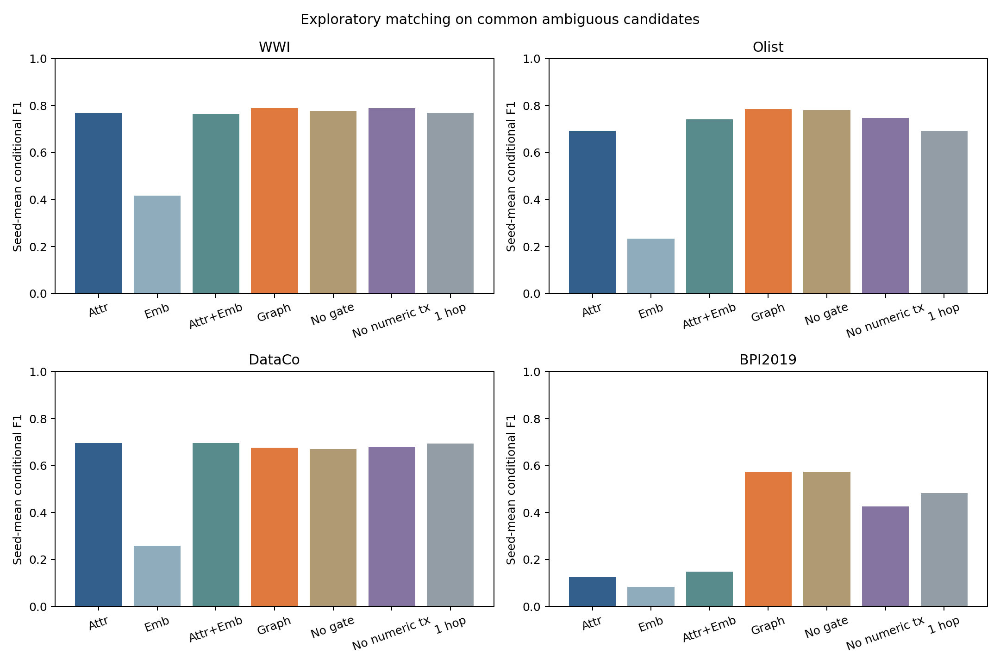
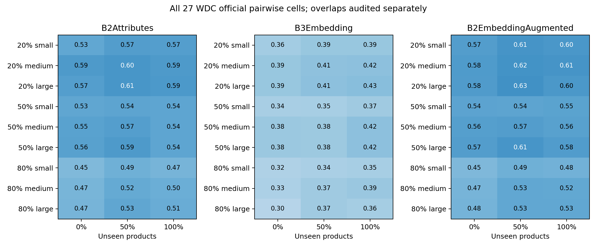
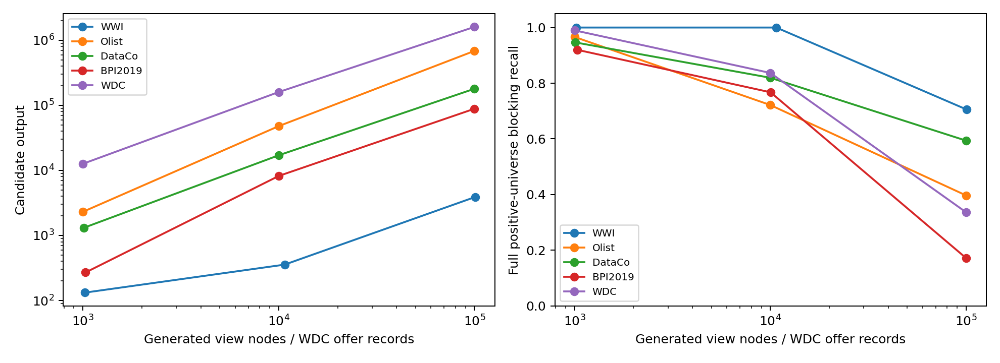
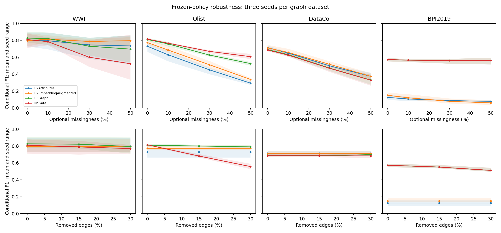
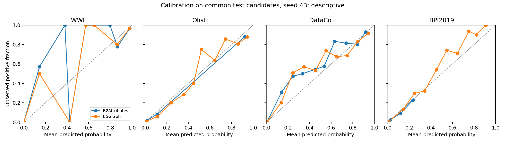

# Five-dataset non-human experiment report

**Exploratory scope expansion requested by the user.** The original WWI/WDC primary study and improvements-v2 remain unchanged. E6 human study is excluded. All applicable E1-E5 studies are executed; WDC ERP query/graph-context tests are not applicable because the supplied benchmark has no transaction relationships.

## Input roles and full-source fidelity

| Dataset | Full-source scope | Matching truth and scope |
|---|---|---|
| WWI | 249,786 nodes / 274,856 edges | 240 original masters; preserved 49-group test split; richer typed transaction summaries |
| Olist | 1,569,937 nodes / 1,775,243 edges | 2,913 eligible natural repeat customers; two distinct observed accounts with histories |
| DataCo | 267,103 nodes / 607,478 edges | 1,500 stable-hash sampled customers from 10,075 eligible; controlled aliases, disjoint orders |
| BPI2019 | 1,926,659 nodes / 7,138,894 edges | 1,378 eligible anonymized vendors; controlled descriptive views, disjoint purchase cases |
| WDC | 10,422 offers, 27 official split files | 27 pairwise configurations x 3 seeds; 4,500 official test pairs per cell |

Full-source Olist includes all nine files plus derived postal-prefix grouping nodes. DataCo retains all 180,519 row observations and audits normalization conflicts. BPI imports all 251,734 cases / 1,595,923 events and validates eight structural relationship sets. Native relational joins define E1 expected edge sets; lineage, dangling edges and repeated edge import are checked. WWI full-source E1 is reused from its preserved verified run.

DataCo publisher downloads returned HTTP 403. Its structured CSV is from the documented mirror with recorded SHA-256, 53 columns and 180,519 rows; publisher-byte equality is not claimed. BPI uses the publisher-linked legacy Figshare file and verifies the publisher MD5. Olist is official Kaggle version 2. Acquisition metadata is in `data/manifests/expanded_downloads.json`.

## Matching comparisons

Seed means below are **conditional F1 on identical candidate pairs**, on the attribute-defined ambiguous stratum. End-to-end recall/F1, retained positives, candidate counts and subgroup denominators are saved separately. The retrieval cap can miss true pairs; a small conditional F1 gain cannot establish a full-pipeline gain.

| Method | WWI | Olist | DataCo | BPI2019 |
|---|---:|---:|---:|---:|
| B0Exact | 0.3402 | 0.7502 | 0.1994 | 0.0538 |
| B1Fuzzy | 0.7145 | 0.1039 | 0.2001 | 0.0639 |
| B2Attributes | 0.7688 | 0.6919 | 0.6962 | 0.1242 |
| B3Embedding | 0.4157 | 0.2327 | 0.2594 | 0.0840 |
| B2EmbeddingAugmented | 0.7626 | 0.7414 | 0.6962 | 0.1492 |
| B5Graph | 0.7888 | 0.7842 | 0.6750 | 0.5734 |
| NoGate | 0.7763 | 0.7806 | 0.6710 | 0.5734 |
| NoSupport | 0.7879 | 0.7913 | 0.6780 | 0.5465 |
| NoContext | 0.7688 | 0.6919 | 0.6962 | 0.1242 |
| NoTransactions | 0.7887 | 0.7474 | 0.6790 | 0.4264 |
| OneHop | 0.7688 | 0.6919 | 0.6946 | 0.4827 |
| B4Flat | 0.7888 | 0.7842 | 0.6750 | 0.5734 |
| UnitWeights | 0.7440 | 0.7842 | 0.6750 | 0.5734 |

| Dataset | Seed | B5 minus B2 F1 | Paired group-bootstrap 95% interval |
|---|---:|---:|---|
| WWI | 17 | +0.0419 | [-0.0386, +0.1371] |
| WWI | 29 | +0.0000 | [+0.0000, +0.0000] |
| WWI | 43 | +0.0183 | [+0.0000, +0.0612] |
| Olist | 17 | +0.0252 | [-0.0015, +0.0511] |
| Olist | 29 | +0.2043 | [+0.0795, +0.3119] |
| Olist | 43 | +0.0476 | [+0.0190, +0.0739] |
| DataCo | 17 | -0.0347 | [-0.0860, +0.0182] |
| DataCo | 29 | -0.0074 | [-0.0388, +0.0315] |
| DataCo | 43 | -0.0212 | [-0.0631, +0.0213] |
| BPI2019 | 17 | +0.4341 | [+0.3416, +0.5177] |
| BPI2019 | 29 | +0.4876 | [+0.3993, +0.5764] |
| BPI2019 | 43 | +0.4261 | [+0.3500, +0.5049] |

B5Graph versus B2Attributes is the controlled addition-of-context contrast. B4Flat uses independently SQL-extracted identical evidence and the same trained policy; exact scores agree within 1e-12. B2EmbeddingAugmented and B3Embedding are additional attribute references; they do not imply reproduction of literature fine-tuned neural models.

All learned families share the same five-choice LR/RF selection catalog. Training fits TF-IDF and estimators; disjoint validation canonical groups handle selection, sigmoid calibration and threshold policy. Cross-role pairs are omitted, with development-only prevalence correction. Models/policies are persisted before test-label metrics. This does not eliminate small-role uncertainty, conditional-selection bias or development-to-test prior shift.

WWI exposes authentic QuantityPerOuter compatibility to attribute baselines and uses it for stock-unit conversion in contextual purchasing quantities. Stock movements remain signed stock units. Supplier purchasing outers are kept separate from quantities that finance does not provide. BPI quantity is absent; its amount is the first-event anonymized cumulative net worth per purchase case, not an invoice-payment sum.

Olist has sparse histories and lacks customer names. Its descriptive attributes are city/state/postal prefix. Transaction context includes authentic product-category and seller-state paths. A minimal diagnostic fixture lacked sufficient shared support; that pre-training source-adapter amendment and the minimal fixture are retained. BPI vendor names/anonymized vendor IDs and company/source IDs are excluded from matching text. Its baseline descriptive fields are modal spend-area/document-type/classification descriptors from each disjoint case history, rather than literal vendor master attributes. Its comparison measures additional detailed history summaries beyond those coarse descriptors.

Adapter semantics matter: WWI retains its independently inferred master-anchor gate; the other graph datasets use support from two distinct projected category tags, which does not establish two independently matched entities. Prefix-only tags represent categorical missingness and can contribute to this heuristic support; available context does not guarantee two known informative categories. OneHop refers to the normalized entity/transaction/category projection, rather than native purchase/event graph depth, and uses local activity support. NoTransactions removes numerical/date/unit transaction summaries but retains category, activity and degree information. UnitWeights applies the frozen weighted model and policy to unit-weight inputs; this is an input-weight stress test, not a separately retrained ablation. The prior improvements-v2 study contains a separately trained unweighted WWI comparator.

The interrupted run was continued without refitting completed WWI models. Q1 SQL was optimized by deduplicating local entity/category incidence before joining identities; answer semantics are unchanged and parity is checked throughout. All WWI E5 trials were rerun with this query implementation. The prior six measurements and previous source are preserved under e5-before-Q1-optimization and code_amendments; manifest amendments record both code hashes.

A provenance review corrected Olist transaction projections that inherited their owner customer filename. Their native row origin is now the order-item file; date/status and category/seller fields retain their documented joined origins. All three Olist query-control evaluations and nine scaling trials were rerun, with previous measurements retained. Matching estimators and thresholds were preserved; every frozen score is independently replayed after the repair.

## WDC: all official pairwise configurations

Mean test F1 across three training seeds. Original official train/test pairs are unchanged. Validation alone is internally divided by product group for development roles.

| Corner cases | Development | Unseen | B2 | B3 embedding | B2 + embedding | Overlapping train/test offers |
|---:|---|---:|---:|---:|---:|---:|
| 20% | large | 0% | 0.5680 | 0.3888 | 0.5813 | 0 |
| 20% | large | 50% | 0.6050 | 0.4141 | 0.6269 | 269 |
| 20% | large | 100% | 0.5899 | 0.4293 | 0.5955 | 0 |
| 20% | medium | 0% | 0.5872 | 0.3889 | 0.5826 | 0 |
| 20% | medium | 50% | 0.6029 | 0.4115 | 0.6199 | 155 |
| 20% | medium | 100% | 0.5870 | 0.4162 | 0.6130 | 0 |
| 20% | small | 0% | 0.5295 | 0.3565 | 0.5705 | 0 |
| 20% | small | 50% | 0.5705 | 0.3877 | 0.6108 | 97 |
| 20% | small | 100% | 0.5696 | 0.3903 | 0.6003 | 0 |
| 50% | large | 0% | 0.5579 | 0.3812 | 0.5721 | 0 |
| 50% | large | 50% | 0.5881 | 0.3773 | 0.6068 | 274 |
| 50% | large | 100% | 0.5381 | 0.4171 | 0.5781 | 0 |
| 50% | medium | 0% | 0.5546 | 0.3812 | 0.5640 | 0 |
| 50% | medium | 50% | 0.5671 | 0.3773 | 0.5710 | 162 |
| 50% | medium | 100% | 0.5381 | 0.4171 | 0.5552 | 0 |
| 50% | small | 0% | 0.5333 | 0.3423 | 0.5432 | 0 |
| 50% | small | 50% | 0.5394 | 0.3465 | 0.5420 | 110 |
| 50% | small | 100% | 0.5352 | 0.3704 | 0.5481 | 0 |
| 80% | large | 0% | 0.4692 | 0.2994 | 0.4761 | 0 |
| 80% | large | 50% | 0.5313 | 0.3706 | 0.5290 | 272 |
| 80% | large | 100% | 0.5056 | 0.3551 | 0.5291 | 0 |
| 80% | medium | 0% | 0.4672 | 0.3288 | 0.4706 | 0 |
| 80% | medium | 50% | 0.5188 | 0.3689 | 0.5293 | 159 |
| 80% | medium | 100% | 0.4982 | 0.3850 | 0.5240 | 0 |
| 80% | small | 0% | 0.4462 | 0.3235 | 0.4503 | 0 |
| 80% | small | 50% | 0.4903 | 0.3361 | 0.4899 | 110 |
| 80% | small | 100% | 0.4700 | 0.3466 | 0.4818 | 0 |

Some supplied seen/half-seen files contain offer overlaps despite the benchmark documentation describing offer-disjoint splits. All official cells are still measured and explicitly flagged; contaminated cells are not presented as clean held-out evidence. `split_integrity.csv` includes train/validation and validation/test overlap as well. A separately reported offer-disjoint subset retains exact denominators without altering official pairs or fitting on test. No unseen configuration is selected from its test performance.

## Queries, robustness and calibration

Each graph dataset runs eight nonempty source-UID query tasks under unreconciled, predicted and oracle identity maps. SQL and graph answers agree exactly under each map. Source-local controls Q2/Q4 are distinguished from identity-sensitive category paths, totals, positive-value transaction links, identity pairs and provenance. Monetary aggregation uses cent-rounded source units and is not described as actual paid spend when the schema does not support it. WWI additionally preserves original native Q1-Q6 and executes planned native Q7/Q8 category/lineage tasks.

E4 evaluates clean/no-anchor conditions; attribute noise 30/50%; optional missingness 10/30/50%; relation removal 15/30%; typed misleading-edge rewiring 15/30%; visible-lineage missingness 30%. Methods include no-context/no-support/no-gate/unit-weight/no-transaction/one-hop ablations. All conditions use frozen pairs, estimators and policies. Perturbation logs never become correctness features. WDC has attribute stress only, plus all hardness/unseen/size variants.

Per-seed paired group-bootstrap intervals, sparse/dense and supported/unsupported subgroups, hard challenges, raw/calibrated Brier/log-loss/ECE, reliability bins and coverage-risk curves are saved. WWI supplier/stock-item breakdowns are in wwi_entity_type_metrics.csv, with only three independent held-out suppliers per seed. Calibration metrics on small imbalanced samples remain descriptive. Accepted false merges after one-to-one constraints are audited separately from pair-classifier false positives.

| Dataset | Accepted B5 links, three seeds | False merges |
|---|---:|---:|
| WWI | 107 | 1 |
| Olist | 1092 | 37 |
| DataCo | 636 | 62 |
| BPI2019 | 372 | 54 |

## Three-point scaling

Every dataset has 1,000 / 10,000 / 100,000 source-view node or offer-record targets, three trials each. Graph targets include complete entity/transaction/category units and may slightly exceed the target. Independent groups grow only until the original test pool is exhausted; later aliases are replicas. Matching recall includes every same-original-entity cross-silo positive, including cross-replica pairs. Query workloads use the same per-copy oracle identities for both representations, independently of matching features.

| Dataset | Target | Actual nodes, trial 0 | Matching records | Candidates | Blocking recall |
|---|---:|---:|---:|---:|---:|
| WWI | 1,000 | 1,021 | 36 | 132 | 1.0000 |
| WWI | 10,000 | 10,722 | 96 | 356 | 1.0000 |
| WWI | 100,000 | 100,729 | 974 | 3,896 | 0.7053 |
| Olist | 1,000 | 1,000 | 414 | 2,309 | 0.9662 |
| Olist | 10,000 | 10,001 | 4,308 | 47,913 | 0.7216 |
| Olist | 100,000 | 100,001 | 43,176 | 687,264 | 0.3968 |
| DataCo | 1,000 | 1,011 | 112 | 1,312 | 0.9464 |
| DataCo | 10,000 | 10,001 | 1,150 | 17,074 | 0.8196 |
| DataCo | 100,000 | 100,012 | 11,470 | 179,974 | 0.5936 |
| BPI2019 | 1,000 | 1,032 | 50 | 270 | 0.9200 |
| BPI2019 | 10,000 | 10,023 | 560 | 8,231 | 0.7674 |
| BPI2019 | 100,000 | 100,014 | 5,566 | 88,716 | 0.1718 |
| WDC | 1,000 | 1,000 offers | 1,000 | 12,638 | 0.9898 |
| WDC | 10,000 | 10,000 offers | 10,000 | 160,137 | 0.8369 |
| WDC | 100,000 | 100,000 offers | 100,000 | 1,606,844 | 0.3363 |

ETL/remapping, blocking, complete feature construction, scoring, graph preparation and SQL loading/indexing are timed separately. Graph/SQL batch and individual-template p50/p95 are measured after explicit warm-up. Process peak RSS is sampled every 50 ms, including incremental baseline; allocator retention affects the absolute process peak. Output cardinality is bounded by design, with measured recall loss. No subquadratic total-computation, universal graph-engine superiority, independent-enterprise diversity or production-readiness claim follows. WDC has offer indexing/scoring throughput only, because enterprise queries are inapplicable.

## Completion and limits

All applicable non-human E1-E5 experiments and planned optional embedding/one-hop/query extensions are executed. E6 is excluded by instruction. Twenty-seven WDC pairwise configurations are tested; multiclass WDC, literature-model reproductions, GNN training, production deployments, RDF/SHACL and a Neo4j UI are separate tasks rather than experiments in this plan.

Dataset-specific adapters, history sampling (up to 40 transactions per view for new graph datasets), controlled aliases for DataCo/BPI, Olist repeat-customer eligibility and source mirror limitations constrain generalization. A positive result is not necessary for completion. The original paper remains a preserved study draft; incorporating this expansion, publication rights, author review and submission are separate unfinished publication work.

See `experiment_coverage.csv`, `verification.json`, `config_snapshot.yaml`, the exact `code_snapshot/`, per-seed frozen models/decisions, source hashes and the acquired-model manifest. No human participants were recruited or contacted.

Robustness plots show three-seed means and ranges, not confidence intervals. Reliability plots show seed 43 with exact per-bin denominators in the corresponding CSV. Candidate slopes use matching source-record counts and are available in `candidate_slopes.csv`; the imposed output cap prevents interpreting these as computational-complexity bounds.
