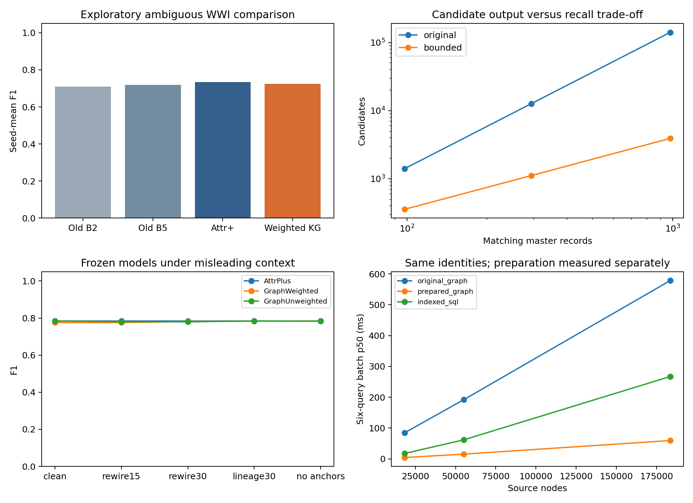
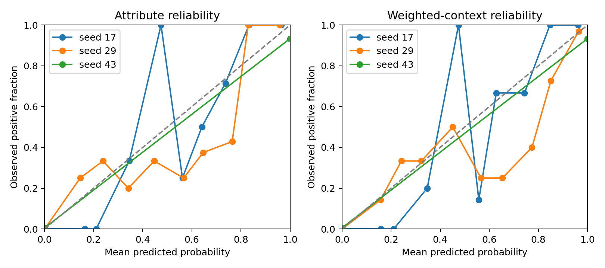
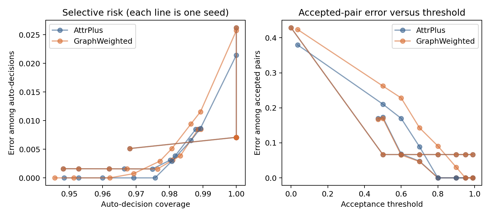

# Exploratory project improvements

The original `initial-core-v3` study and manuscript are preserved. These additions follow prior test review, so every new method/experiment is exploratory. All WWI scorers share the original candidate pairs; WDC remains attribute-only.

## Matching on the original ambiguous test pairs

| Method | Seed-mean F1 |
|---|---:|
| OriginalB2 | 0.7093 |
| OriginalB5 | 0.7182 |
| AttrPlus | 0.7335 |
| GraphWeighted | 0.7247 |
| GraphUngated | 0.7097 |
| GraphUnweighted | 0.7353 |
| GraphNoSupport | 0.7200 |
| GraphNoContext | 0.7335 |

Model selection, sigmoid calibration and threshold setting use disjoint canonical validation groups. Pairs crossing development roles are omitted from those operations. Test labels are evaluated only after models and policies are written to frozen artifacts.

Role filtering retains same-group positives more often than different-group negatives. Class weights restore full-validation prevalence for selection/calibration/policy using development labels only. This correction cannot restore omitted conditional comparisons; small-role uncertainty and development-to-test prior shift still limit interpretation.

## External WDC attribute results

| Method | Precision | Recall | F1 |
|---|---:|---:|---:|
| OriginalB2 | 0.2685 | 0.7620 | 0.3971 |
| AttrPlus | 0.4243 | 0.6560 | 0.5153 |

Official train/test pairs are unchanged. The official validation partition is internally divided by product group for selection, calibration and policy; exact denominators are in `wdc/freeze.json`. This is a different exploratory development protocol from the original model, so attribute/model/calibration effects are combined.

## Robustness, provenance and abstention

The extension includes optional missingness, additional edge removal, type-safe misleading-edge rewiring, missing lineage metadata, no-anchor fallback, no-support-feature, no-context, no-gate and unit-weight ablations. Random perturbation logs are evaluator-only; injected edge labels never become model features. Original candidate pairs and trained thresholds remain frozen for every stress condition.

| Model | Raw mean ECE | After sigmoid mean ECE |
|---|---:|---:|
| AttrPlus | 0.0202 | 0.0072 |
| GraphWeighted | 0.0209 | 0.0072 |

ECE uses ten uniform bins and is descriptive on a small, imbalanced sample. Brier/log-loss include discrimination and uncertainty; neither alone proves calibration. The calibrated and uncalibrated scores are retained. Coverage-risk and accepted-error rates are available alongside false-positive/negative counts.

## Bounded candidate retrieval and query preparation

| Matching records | Original candidates | Bounded candidates | Original blocking recall | Bounded blocking recall |
|---|---:|---:|---:|---:|
| 98 | 1411 | 357 | 1.0000 | 1.0000 |
| 294 | 12699 | 1116 | 1.0000 | 0.9796 |
| 980 | 141100 | 3920 | 1.0000 | 0.7020 |

The per-left top-k and per-posting budgets enforce bounded output size. This is a designed trade-off, not proof of unchanged recall or subquadratic total compute. Recall counts **all** positive cross-silo aliases, including cross-replica pairs. Replica count does not increase independent population diversity.

| Source nodes | Original graph p50 ms | Prepared graph p50 ms | Indexed SQL p50 ms |
|---|---:|---:|---:|
| 18359 | 84.814 | 4.495 | 17.718 |
| 55077 | 192.021 | 15.361 | 61.837 |
| 183590 | 578.487 | 59.641 | 267.196 |

Preparation time is recorded separately for graph adjacency and SQL indexes. All methods return identical answers under the same identity map. Per-template p50/p95 values are saved, as well as six-template batch values. Timing describes these Python/SQLite implementations on the saved hardware; it is not an intrinsic database superiority claim.

## What remains incomplete

The core study does not yet include transaction date/quantity summaries in matching context, independent dirty ERP sources, embedding/neural comparisons, a Neo4j/Cypher deployment, extensive external robustness, a human review study, or final author/distribution/submission sign-off. Some are optional extensions; the plan coverage audit distinguishes these from required work. No positive hypothesis is required to count an honestly evaluated experiment as complete.

