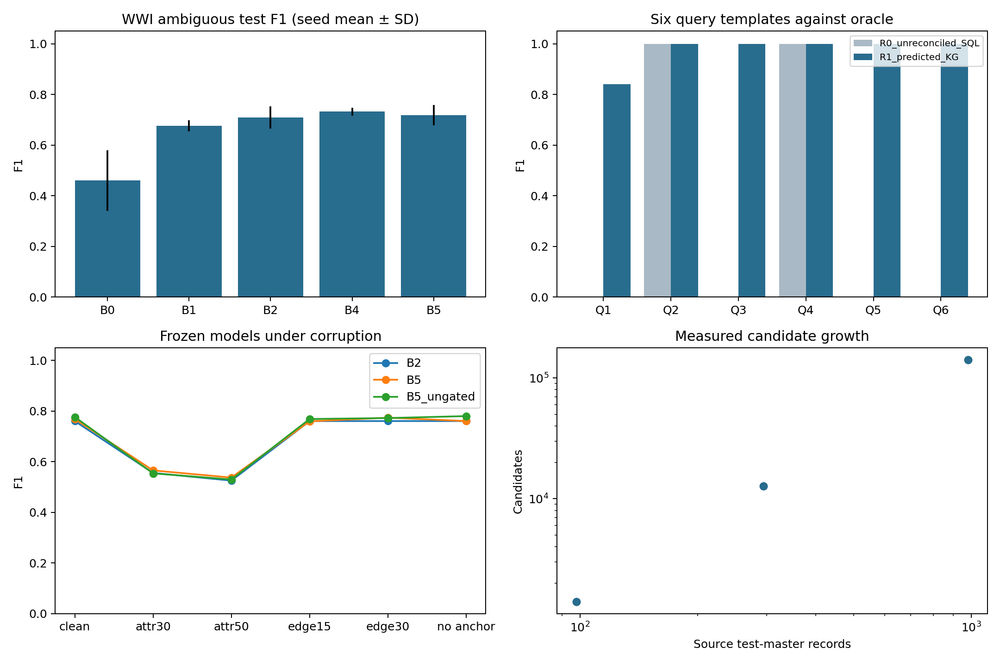

# Initial two-dataset implementation report

Run: `initial-core-v3`. These are measured exploratory results from the implemented prototype; no paper submission or novelty claim is implied.

## Scope and verification

The authentic WWI graph contains 249,786 nodes and 274,856 mapped relationships. Node/edge precision and recall and node lineage coverage are 100%/100%, 100%/100%, and 100%. Eight independent source SQL join counts agree with graph counts. Re-import is idempotent.

The independent population is 13 suppliers and 227 stock items. Test partitions contain 3 supplier and 46 stock-item groups. Silo generation and E3 use the disclosed 5,000-movement subset; E1 validates the full extract.

WDC uses the official 50% corner-case/small/100%-unseen configuration, with 2,500 training, 2,500 validation and 4,500 test pairs. The parser verifies no offer overlap. WDC evaluates attributes only.

14 automated control tests pass. Saved metric files were independently recomputed from predictions using scikit-learn; original result/code checksums, nonempty oracle tasks, no-anchor evidence, and SQL/KG query equivalence passed the post-run audit.

## E2 primary ambiguous test comparison

| Seed | Common pairs | Independent test groups | B2 F1 | B5 F1 | Delta | Paired entity-bootstrap 95% interval |
|---|---:|---:|---:|---:|---:|---|
| 17 | 1304 | 49 | 0.6500 | 0.6667 | +0.0167 | [-0.0784, +0.1014] |
| 29 | 1383 | 49 | 0.7532 | 0.7632 | +0.0099 | [+0.0000, +0.0409] |
| 43 | 1403 | 49 | 0.7246 | 0.7246 | +0.0000 | [+0.0000, +0.0000] |

The seed-mean B5–B2 F1 difference is +0.0089. Interpret each uncertainty interval and the small synthetic sample before claiming improvement. These intervals do not establish a real-enterprise population effect.

| WDC attribute model | Precision | Recall | F1 |
|---|---:|---:|---:|
| B0 | 0.0000 | 0.0000 | 0.0000 |
| B1 | 0.2453 | 0.7240 | 0.3664 |
| B2 | 0.2685 | 0.7620 | 0.3971 |

## E3 query results

| Template | Unreconciled SQL mean F1 | Predicted KG mean F1 | Canonical SQL/KG parity |
|---|---:|---:|---|
| Q1 | 0.0000 | 0.8399 | exact across all seeds |
| Q2 | 1.0000 | 1.0000 | exact across all seeds |
| Q3 | 0.0000 | 1.0000 | exact across all seeds |
| Q4 | 1.0000 | 1.0000 | exact across all seeds |
| Q5 | 0.0000 | 1.0000 | exact across all seeds |
| Q6 | 0.0000 | 1.0000 | exact across all seeds |

Q2/Q4 are source-local controls. The unreconciled baseline uses separate source IDs and does not perform name matching. Improved identity-affected queries demonstrate reconciliation benefit, not graph-engine superiority.

## E4 and E5

E4 ran six clean/noise/no-anchor scenarios with B2/B4/B5 and no-context/ungated ablations, using frozen clean candidates and thresholds. False positives, decision coverage and selective risk are saved for each seed. Noise settings are synthetic experimental choices, not measured enterprise error rates.

E5 completed 3 size points with three trials each: 18,359, 55,077 and 183,590 generated source nodes. The fitted candidate-growth exponent is 2.0000. This is the observed behavior of replicated descriptive data; a value near 2 fails the below-quadratic H5 target.

Measurements are for NetworkX and indexed in-memory SQLite on the saved hardware profile. Query timings are warmed six-template batches; RSS is sampled every 50 ms. Replica workload increases record count without adding independent entities, and unique exact-name anchors disappear when descriptive records are replicated.

## Remaining research work

The two primary inputs and E1–E5 now run end to end. Before a submission, validate literature positioning, strengthen source/corruption realism, inspect error cases and uncertainty, consider adversarial-edge and provenance-weight ablations, and write a manuscript grounded in the saved positive/negative results. Any performance-driven revision after these tests must be marked exploratory with a new protocol/run ID. Optional datasets remain deferred.

Detailed evidence: `e1/`, `e2/`, `e3/`, `e4/`, `e5/`, `audit.json`, `input_manifests/`, and `run_manifest.json`.
